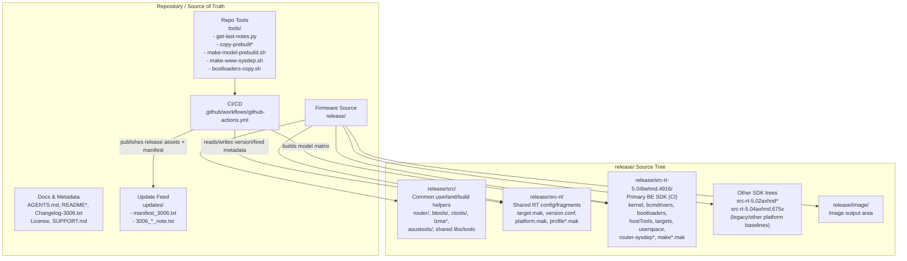
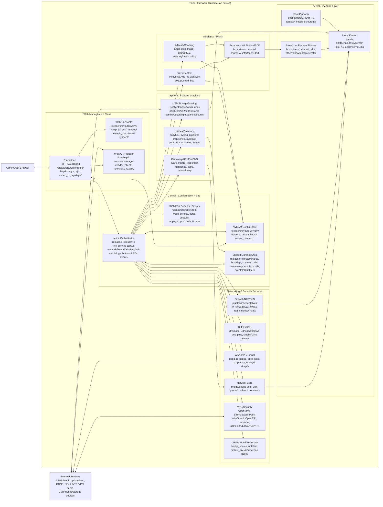
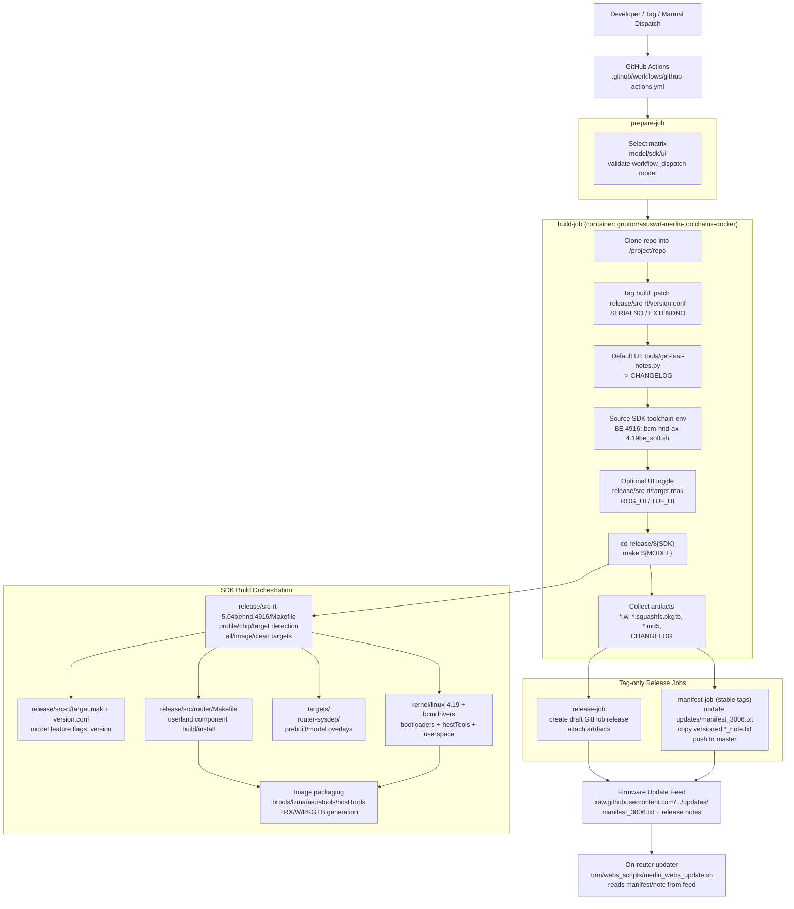

# AsusWrt-Merlin.ng 3006 (Gnuton) — Architecture

## Scope

Analysis based on the 3006 firmware line in this repository. Key sources: `AGENTS.md`, `README.md`, `.github/workflows/github-actions.yml`, `updates/`, `release/src/Makefile`, `release/src/router/Makefile`, `release/src-rt/target.mak`, `release/src-rt/version.conf`, `release/src-rt-5.04behnd.4916/Makefile`, and `release/src/router/{rc,nvram,shared,httpd,www,rom}/`.

> Note: the web UI source is `release/src/router/www/` (not a top-level `www/` directory).

## Diagrams

- [System Architecture](diagrams/system-architecture.mmd)
- [Runtime Architecture](diagrams/runtime-architecture.mmd)
- [Build and Release Pipeline](diagrams/build-release-pipeline.mmd)
- [RC Service Connections](diagrams/rc-service-connections.mmd)

## RC Services

A detailed RC `start_*` service catalog and orchestration overview is available in [rc-services.md](rc-services.md).

## 1) High-Level System Architecture

## 2) Firmware Runtime / Component Architecture

## 3) Build, Packaging, and Release Pipeline

## 4) Source Component Map

| Layer | Key paths | Responsibility |
|---|---|---|
| Repo/CI | `.github/workflows/github-actions.yml`, `tools/`, `updates/` | Build matrix, artifact creation, GitHub release, manifest/note feed publication. |
| Shared RT config | `release/src-rt/target.mak`, `version.conf`, `platform.mak`, `profile*.mak` | Model feature flags, versioning, platform/profile build configuration. |
| Primary BE SDK | `release/src-rt-5.04behnd.4916/` | Kernel/drivers/bootloaders/host tools/targets/sysdep and top-level image orchestration for supported 3006 BE models. |
| Common userland | `release/src/router/` | Router applications, daemons, libs, web, scripts, ROMFS content; reused by SDK builds via symlink/overlay. |
| Init/control | `release/src/router/rc/`, `shared/`, `nvram/` | Boot/init, service orchestration, NVRAM/config persistence, shared APIs/utilities. |
| Web UI/backend | `release/src/router/www/`, `httpd/`, `rom/webs_scripts/` | ASP/JS UI, HTTP/CGI/EJ backend, NVRAM-facing handlers, update/cert/web scripts. |
| Networking | `bridge*`, `iproute2*`, `iptables/ipset/ebtables`, `dnsmasq`, `pppd/rp-pppoe`, `quagga`, `6relayd`, `odhcp6c` | LAN/WAN bridging/routing, DHCP/DNS, firewall/NAT, IPv6, routing protocols. |
| Wireless/AiMesh | `wlceventd`, `wlc_nt`, `wps`, `802.1x`, `asd*`, `amas-utils`, `mapd`, SDK `bcmdrivers/.../wl` | WiFi control, roaming/mesh, WPA/WPS, Broadcom wireless driver stack. |
| VPN/Security/DPI | `openvpn`, `strongswan`, `wireguard-tools`, `openssl*`, `bwdpi_source`, `urlfilterd`, `acme.sh` | VPNs, crypto, certificate management, DPI/parental/filtering. |
| USB/Storage/Sharing | `usbclient`, `usb-modeswitch`, `e2fsprogs`, `ntfs-3g/tuxera`, `samba*`, `vsftpd*`, `minidlna`, `nfs-utils` | USB device/storage handling, filesystems, NAS/media/file sharing services. |
| Kernel/platform | `src-rt-5.04behnd.4916/kernel`, `bcmdrivers`, `shared`, `rdp`, `bootloaders`, `targets` | Linux 4.19/Broadcom kernel platform, hardware drivers, acceleration, boot chain, target profiles. |

## 5) Architectural Constraints

- **3006-only line:** `master` is the 3006 line; CI rejects non-`3006.*` tags; update feed is `manifest_3006.txt`.
- **Proprietary/prebuilt components:** many `prebuilt`/binary/vendor areas (ASUS/Broadcom/Trend Micro/Tuxera) are not modifiable as source.
- **Feature-flag driven builds:** model capabilities are composed through `release/src-rt/target.mak` macros and SDK/profile make fragments.
- **Build-layout reality:** legacy `release/src/Makefile` exists, but supported 3006 BE CI builds through `release/src-rt-5.04behnd.4916/Makefile`.
