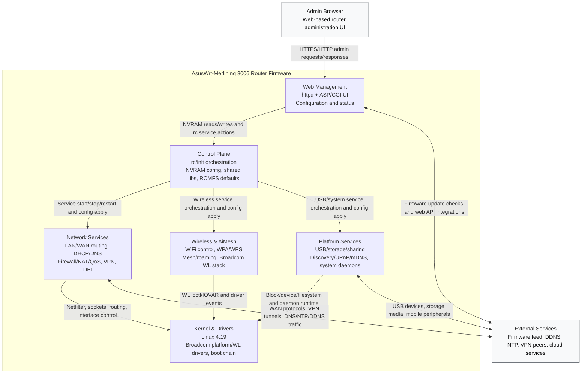
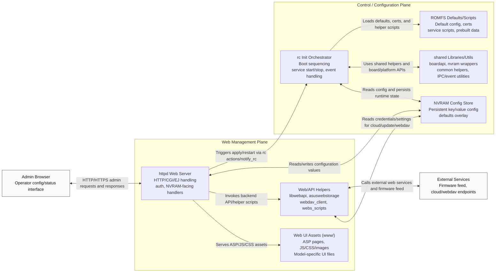
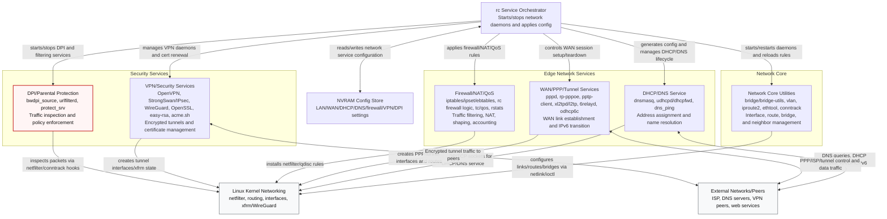
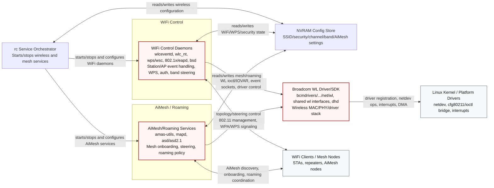
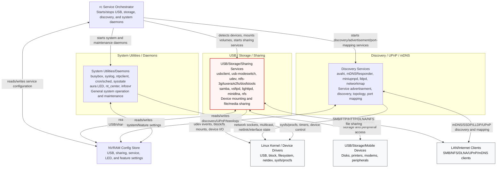

# AsusWrt-Merlin.ng 3006 (Gnuton) — Architecture

## Scope

Analysis based on the 3006 firmware line in this repository. Key sources: `AGENTS.md`, `README.md`, `release/src/Makefile`, `release/src/router/Makefile`, `release/src-rt/target.mak`, `release/src-rt/version.conf`, `release/src-rt-5.04behnd.4916/Makefile`, and `release/src/router/{rc,nvram,shared,httpd,www,rom}/`.

> Note: the web UI source is `release/src/router/www/` (not a top-level `www/` directory).

## Diagrams

- [System Architecture](diagrams/system-architecture.mmd) — high-level system context with major applications and purposes.
- [Control Plane](diagrams/control-plane.mmd) — web UI, httpd, rc, NVRAM, shared libraries, and ROMFS interactions.
- [Network Services](diagrams/network-services.mmd) — routing, DHCP/DNS, WAN, firewall/NAT/QoS, VPN, and DPI services.
- [Wireless & AiMesh](diagrams/wireless-amesh.mmd) — WiFi control, AiMesh/roaming, Broadcom WL stack, and kernel interfaces.
- [USB & System Services](diagrams/usb-system-services.mmd) — USB/storage/sharing, discovery, and system daemons.
- [RC Service Connections](diagrams/rc-service-connections.mmd) — boot/init and RC service orchestration.

**Legend:** red-bordered nodes indicate components with prebuilt/proprietary artifacts linked into the firmware (e.g., `.o` files in `prebuild/`/`prebuilt/` or prebuilt binaries/libs). Edge labels describe interaction purpose.

## RC Services

A detailed RC `start_*` service catalog and orchestration overview is available in [rc-services.md](rc-services.md).

## Router Component Catalog

A component-level catalog for `release/src/router` (purpose, connections, NVRAM keys/prefixes, IPC/bus mechanisms, and domain diagrams) is available in [router-components.md](router-components.md).

## 1) System Architecture

This graph shows the major firmware applications/subsystems and their purposes. Edges are labeled with the primary interaction or data flow.

## 2) Control Plane

The control plane connects the web UI to persistent configuration and service orchestration.

## 3) Network Services

Network and security applications are orchestrated by `rc`, configured through NVRAM, and enforce policy through kernel/netfilter interfaces.

## 4) Wireless & AiMesh

Wireless services are split between user-space control/mesh daemons and the Broadcom wireless/platform driver stack.

## 5) USB & System Services

Platform services cover USB/storage sharing, LAN discovery, and general system daemons.

## 6) RC Service Orchestration

The RC layer is the runtime control hub. The detailed `start_*` catalog is in [rc-services.md](rc-services.md).

```mermaid
flowchart TB
    classDef proprietary fill:#fff5f5,stroke:#c92a2a,stroke-width:2px,color:#111;

    INIT["init/rc boot\nSystem initialization and main control loop"]
    SS["start_services()\nCore service orchestrator in services.c"]
    LAN["start_lan()\nLAN/bridge/VLAN/WiFi bringup in lan.c"]
    WAN["start_wan() / start_wan_if()\nWAN interface and protocol bringup in wan.c"]
    USB["start_usb()\nUSB device/storage initialization in usb.c"]
    WL["start_wl() / start_wireless()\nWireless radio/interface initialization"]
    FW["start_firewall()\nNetfilter/firewall/NAT rule application in firewall.c"]
    JFFS["start_jffs2()/start_ubifs()\nPersistent writable filesystem mount"]

    SS -->|"starts/stops core daemons"| CORE["Core/System Services\nsyslogd/klogd/logger, hotplug2, cron, ntp, watchdogs, LEDs"]
    SS -->|"starts/stops network daemons"| NETSVC["Network Services\ndnsmasq, stubby, httpd, upnp, networkmap, wanduck, sshd, snmpd"]
    SS -->|"starts/stops wireless daemons"| WLSVC["Wireless Services\neapd, nas/wpa, wlceventd, bsd, asd, AMAS, wps"]
    SS -->|"starts/stops security daemons"| SECSVC["Security/VPN/DPI\nOpenVPN/WireGuard hooks, BWDPI checks, letsencrypt, conn_diag"]
    SS -->|"starts/stops USB/app daemons"| USBSVC["USB/App Services\nnas_services, samba, ftpd, minidlna/DMS, webdav, timemachine"]
    SS -->|"starts/stops feature daemons"| FEAT["Feature Daemons\naura RGB, AiCloud/awsiot, infosvr, nt_center, sysstate"]

    WLSVC -.->|"includes prebuilt/proprietary components"| PROP["Prebuilt/proprietary examples\nasd, wlceventd, bsd, amas-utils libs"]:::proprietary

    LAN -->|"configures LAN interfaces/bridge/VLAN"| BR["Bridge/VLAN/LAN IF\nstart_vlan, start_lan_port, start_lan_wl, DHCP/DNS reload"]
    WAN -->|"brings up WAN protocol/interface"| WANIF["WAN Interface Bringup\nDHCP/PPPoE/USB modem, start_wan6, 6relayd/dhcp6c/rdisc6"]
    WAN -->|"applies WAN-dependent features"| WANFEAT["WAN Features\nVPN client/server hooks, QoS, firewall, DDNS, UPnP, routes"]
    USB -->|"starts NAS/app stack"| NAS["NAS/App Stack\nstart_nas_services, samba, ftpd, DMS, webdav, timemachine"]

    NVRAM["NVRAM Config Bus\nnvram/* shared/* persistent key-value config"]
    HTTPD["httpd Web Backend\nCGI/ASP handlers in httpd/* serving www/*"]
    RCMD["RC Dispatcher\nrc rc_service / notify_rc event handling"]

    INIT -->|"invokes during boot"| SS
    INIT -->|"invokes during boot"| LAN
    INIT -->|"invokes during boot"| WAN
    INIT -->|"invokes during boot"| USB
    INIT -->|"invokes during boot"| WL
    INIT -->|"invokes during boot"| FW
    INIT -->|"invokes during boot"| JFFS

    NVRAM <-->|"reads/writes service configuration"| SS
    NVRAM <-->|"reads/writes LAN configuration"| LAN
    NVRAM <-->|"reads/writes WAN configuration"| WAN
    NVRAM <-->|"reads/writes UI/config state"| HTTPD
    HTTPD -->|"applies settings via rc service actions"| RCMD
    RCMD -->|"dispatches service start/stop/restart"| SS
    RCMD -->|"dispatches LAN reconfiguration"| LAN
    RCMD -->|"dispatches WAN reconfiguration"| WAN
    RCMD -->|"dispatches firewall reload"| FW
```

## 7) Source Component Map

| Layer | Key paths | Responsibility |
|---|---|---|
| Repo/CI | `.github/workflows/github-actions.yml`, `tools/`, `updates/` | Build matrix, artifact creation, GitHub release, manifest/note feed publication. |
| Shared RT config | `release/src-rt/target.mak`, `version.conf`, `platform.mak`, `profile*.mak` | Model feature flags, versioning, platform/profile build configuration. |
| Primary BE SDK | `release/src-rt-5.04behnd.4916/` | Kernel/drivers/bootloaders/host tools/targets/sysdep and top-level image orchestration for supported 3006 BE models. |
| Common userland | `release/src/router/` | Router applications, daemons, libs, web, scripts, ROMFS content; reused by SDK builds via symlink/overlay. |
| Init/control | `release/src/router/rc/`, `shared/`, `nvram/` | Boot/init, service orchestration, NVRAM/config persistence, shared APIs/utilities. |
| Web UI/backend | `release/src/router/www/`, `httpd/`, `rom/webs_scripts/` | ASP/JS UI, HTTP/CGI/EJ backend, NVRAM-facing handlers, update/cert/web scripts. |
| Networking | `bridge*`, `iproute2*`, `iptables/ipset/ebtables`, `dnsmasq`, `pppd/rp-pppoe`, `quagga`, `6relayd`, `odhcp6c` | LAN/WAN bridging/routing, DHCP/DNS, firewall/NAT, IPv6, routing protocols. |
| Wireless/AiMesh | `wlceventd`, `wlc_nt`, `wps`, `802.1x`, `asd*`, `amas-utils`, `mapd`, SDK `bcmdrivers/.../wl` | WiFi control, roaming/mesh, WPA/WPS, Broadcom wireless driver stack. |
| VPN/Security/DPI | `openvpn`, `strongswan`, `wireguard-tools`, `openssl*`, `bwdpi_source`, `urlfilterd`, `acme.sh` | VPNs, crypto, certificate management, DPI/parental/filtering. |
| USB/Storage/Sharing | `usbclient`, `usb-modeswitch`, `e2fsprogs`, `ntfs-3g/tuxera`, `samba*`, `vsftpd*`, `minidlna`, `nfs-utils` | USB device/storage handling, filesystems, NAS/media/file sharing services. |
| Kernel/platform | `src-rt-5.04behnd.4916/kernel`, `bcmdrivers`, `shared`, `rdp`, `bootloaders`, `targets` | Linux 4.19/Broadcom kernel platform, hardware drivers, acceleration, boot chain, target profiles. |

## 8) Architectural Constraints

- **3006-only line:** `master` is the 3006 line; CI rejects non-`3006.*` tags; update feed is `manifest_3006.txt`.
- **Proprietary/prebuilt components:** many `prebuilt`/binary/vendor areas (ASUS/Broadcom/Trend Micro/Tuxera) are not modifiable as source.
- **Feature-flag driven builds:** model capabilities are composed through `release/src-rt/target.mak` macros and SDK/profile make fragments.
- **Build-layout reality:** legacy `release/src/Makefile` exists, but supported 3006 BE CI builds through `release/src-rt-5.04behnd.4916/Makefile`.
