# RC Services (release/src/router/rc)

This document catalogs `start_*` service/function entry points found in `release/src/router/rc/*.c`, their corresponding stop functions when present, and how they connect to the main RC orchestrators.

## Overview

- **Main orchestrator:** `start_services()` / `stop_services()` in `services.c` coordinates most long-running services.
- **Boot/init:** `init.c` and `rc.c` handle early boot, mounts, hardware init, and invoke core startup paths (`start_jffs2/ubifs`, `start_lan`, `start_wan`, `start_usb`, `start_services`, wireless init).
- **Network bringup:** `lan.c` and `wan.c` configure interfaces/bridges/VLANs and start network-dependent services (DHCP/DNS, firewall, WAN daemons, IPv6).
- **USB/NAS:** `usb.c` handles USB/storage discovery and starts NAS/app services (`start_nas_services`, Samba/FTP/WebDAV/minidlna/Timemachine, etc.).
- **Config/control plane:** `httpd` and CLI/scripts write NVRAM and trigger `rc` actions (`notify_rc`, `rc_service`, restart/start/stop). Services read NVRAM through `nvram/*` and `shared/*`.

## Connection Diagram

See [diagrams/rc-service-connections.mmd](diagrams/rc-service-connections.mmd).

```mermaid
flowchart TB
    classDef proprietary fill:#fff5f5,stroke:#c92a2a,stroke-width:2px,color:#111;

    INIT["init/rc boot\nSystem initialization and main control loop"]
    SS["start_services()\nCore service orchestrator in services.c"]
    LAN["start_lan()\nLAN/bridge/VLAN/WiFi bringup in lan.c"]
    WAN["start_wan() / start_wan_if()\nWAN interface and protocol bringup in wan.c"]
    USB["start_usb()\nUSB device/storage initialization in usb.c"]
    WL["start_wl() / start_wireless()\nWireless radio/interface initialization"]
    FW["start_firewall()\nNetfilter/firewall/NAT rule application in firewall.c"]
    JFFS["start_jffs2()/start_ubifs()\nPersistent writable filesystem mount"]

    SS -->|"starts/stops core daemons"| CORE["Core/System Services\nsyslogd/klogd/logger, hotplug2, cron, ntp, watchdogs, LEDs"]
    SS -->|"starts/stops network daemons"| NETSVC["Network Services\ndnsmasq, stubby, httpd, upnp, networkmap, wanduck, sshd, snmpd"]
    SS -->|"starts/stops wireless daemons"| WLSVC["Wireless Services\neapd, nas/wpa, wlceventd, bsd, asd, AMAS, wps"]
    SS -->|"starts/stops security daemons"| SECSVC["Security/VPN/DPI\nOpenVPN/WireGuard hooks, BWDPI checks, letsencrypt, conn_diag"]
    SS -->|"starts/stops USB/app daemons"| USBSVC["USB/App Services\nnas_services, samba, ftpd, minidlna/DMS, webdav, timemachine"]
    SS -->|"starts/stops feature daemons"| FEAT["Feature Daemons\naura RGB, AiCloud/awsiot, infosvr, nt_center, sysstate"]

    WLSVC -.->|"includes prebuilt/proprietary components"| PROP["Prebuilt/proprietary examples\nasd, wlceventd, bsd, amas-utils libs"]:::proprietary

    LAN -->|"configures LAN interfaces/bridge/VLAN"| BR["Bridge/VLAN/LAN IF\nstart_vlan, start_lan_port, start_lan_wl, DHCP/DNS reload"]
    WAN -->|"brings up WAN protocol/interface"| WANIF["WAN Interface Bringup\nDHCP/PPPoE/USB modem, start_wan6, 6relayd/dhcp6c/rdisc6"]
    WAN -->|"applies WAN-dependent features"| WANFEAT["WAN Features\nVPN client/server hooks, QoS, firewall, DDNS, UPnP, routes"]
    USB -->|"starts NAS/app stack"| NAS["NAS/App Stack\nstart_nas_services, samba, ftpd, DMS, webdav, timemachine"]

    NVRAM["NVRAM Config Bus\nnvram/* shared/* persistent key-value config"]
    HTTPD["httpd Web Backend\nCGI/ASP handlers in httpd/* serving www/*"]
    RCMD["RC Dispatcher\nrc rc_service / notify_rc event handling"]

    INIT -->|"invokes during boot"| SS
    INIT -->|"invokes during boot"| LAN
    INIT -->|"invokes during boot"| WAN
    INIT -->|"invokes during boot"| USB
    INIT -->|"invokes during boot"| WL
    INIT -->|"invokes during boot"| FW
    INIT -->|"invokes during boot"| JFFS

    NVRAM <-->|"reads/writes service configuration"| SS
    NVRAM <-->|"reads/writes LAN configuration"| LAN
    NVRAM <-->|"reads/writes WAN configuration"| WAN
    NVRAM <-->|"reads/writes UI/config state"| HTTPD
    HTTPD -->|"applies settings via rc service actions"| RCMD
    RCMD -->|"dispatches service start/stop/restart"| SS
    RCMD -->|"dispatches LAN reconfiguration"| LAN
    RCMD -->|"dispatches WAN reconfiguration"| WAN
    RCMD -->|"dispatches firewall reload"| FW
```

## Key Orchestrators and Connections

| Orchestrator | File | Responsibility | Typical connections |
|---|---|---|---|
| `start_services()` / `stop_services()` | `services.c` | Starts/stops most user-facing daemons and feature services. | DNS/DHCP, HTTPD, SSH/Telnet, UPnP, NTP, logging, watchdogs, AiMesh/ASD, BWDPI checks, cloud/notification services, USB idle, LEDs. |
| `start_lan()` | `lan.c` | Initializes LAN bridge, VLAN/ports, wireless LAN setup, hostname/routes, IPv6 LAN state. | `start_vlan`, `start_lan_port`, `start_lan_wl*`, snooper, bridge/netif setup, interacts with NVRAM and wireless config. |
| `start_wan()` / `start_wan_if()` | `wan.c` | Brings up WAN interfaces and protocol-specific connections (DHCP, PPPoE, PPTP/L2TP, USB modem, IPv6). | `start_firewall`, `start_dnsmasq`, UPnP, DDNS, QoS, VPNs, IPv6 tunnels/6relayd/dhcp6c/rdisc6, wanduck. |
| `start_usb()` / `start_nas_services()` | `usb.c` | Detects USB/storage devices and starts NAS/media services. | Samba, FTP, NFS, minidlna/DMS, WebDAV, Timemachine, cloud sync, printer/LPD, disk monitor/swap. |
| `start_firewall()` | `firewall.c` | Builds iptables/ipset/ebtables rules for WAN/LAN, NAT, filtering, QoS hooks. | Called by WAN/LAN/service changes; depends on NVRAM, interface state, BWDPI/parental control settings. |
| `start_wl()` / wireless init | `lan.c` / `services.c` / platform code | Initializes wireless interfaces and related daemons. | eapd/nas, wlceventd, wlcscan/wlcconnect, WPS, AiMesh/ASD, band steering. |
| `init.c` boot flow | `init.c` | System initialization, mounts, pre-network setup, watchdog/hotplug, invokes main startup. | jffs2/ubifs, hotplug2, watchdogs, start_lan/start_wan/start_services/start_usb. |

## Notes

- The table below is auto-extracted from `start_*` function definitions in `release/src/router/rc/*.c`.
- Some `start_*` functions are internal helpers (not standalone daemons) or have platform-specific variants; duplicates may exist in alternate QoS implementations (`qos.c`, `qos_multiwan.c`, `qos_multi_wan_if.c`).
- `In start_services` indicates the function name appears in `start_services()` in `services.c`; services may also be started by LAN/WAN/USB/init/CLI flows.

---

Total unique `start_*` service functions in `release/src/router/rc/*.c`: **200**

Generated from function definitions and nearby comments; descriptions may be brief where source comments are absent.

## ai_service.c

| Service | Start | Stop | In `start_services` | Args | Notes |
|---|---:|---:|:---:|---|---|
| `start_ai_reboot` | 1223 | - | no | `void` |  |
| `start_ai_response_check` | 1272 | ai_service.c:1266 | no | `void` |  |
| `start_ai_service` | 1286 | ai_service.c:1280 | yes | `void` |  |
| `start_ai_tftpd` | 1231 | ai_service.c:1255 | no | `void` |  |
| `start_ai_upgrade` | 263 | - | no | `char *filename` | webs_state_ai_error => 4(aiboard fetch firmware failed), 5(aiboard upgrade failed) webs_state_ai_upgrade => 1(Download a |

## ate.c

| Service | Start | Stop | In `start_services` | Args | Notes |
|---|---:|---:|:---:|---|---|
| `start_envrams` | 5488 | ate.c:5523 | no | `void` |  |

## cifs.c

| Service | Start | Stop | In `start_services` | Args | Notes |
|---|---:|---:|:---:|---|---|
| `start_cifs` | 14 | cifs.c:19 | yes | `void` |  |

## dsl.c

| Service | Start | Stop | In `start_services` | Args | Notes |
|---|---:|---:|:---:|---|---|
| `start_dsl` | 540 | dsl.c:617, dsl.c:706 | no | `` |  |

## erp_monitor.c

| Service | Start | Stop | In `start_services` | Args | Notes |
|---|---:|---:|:---:|---|---|
| `start_erp_monitor` | 1246 | erp_monitor.c:1241 | yes | `` |  |

## firewall.c

| Service | Start | Stop | In `start_services` | Args | Notes |
|---|---:|---:|:---:|---|---|
| `start_firewall` | 8961 | - | no | `int wanunit, int lanunit` | int start_firewall(char wan_if, char wan_ip, char lan_if, char lan_ip) |

## gre.c

| Service | Start | Stop | In `start_services` | Args | Notes |
|---|---:|---:|:---:|---|---|
| `start_l2gre` | 55 | gre.c:119 | no | `int unit` |  |
| `start_l3gre` | 245 | gre.c:304 | no | `int unit` |  |

## init.c

| Service | Start | Stop | In `start_services` | Args | Notes |
|---|---:|---:|:---:|---|---|
| `start_hw_wdt` | 25144 | - | no | `void` |  |

## interface.c

| Service | Start | Stop | In `start_services` | Args | Notes |
|---|---:|---:|:---:|---|---|
| `start_vlan` | 688 | interface.c:868 | no | `void` | configure/start vlan interface(s) based on nvram settings |

## jffs2.c

| Service | Start | Stop | In `start_services` | Args | Notes |
|---|---:|---:|:---:|---|---|
| `start_jffs2` | 304 | jffs2.c:515 | no | `void` |  |

## lan.c

| Service | Start | Stop | In `start_services` | Args | Notes |
|---|---:|---:|:---:|---|---|
| `start_fbwifi_check` | 6592 | lan.c:6588 | no | `` |  |
| `start_fbwifi_config` | 6600 | services.c:25509 | no | `` |  |
| `start_lan` | 1384 | lan.c:2851 | no | `void` |  |
| `start_lan_ipv6` | 814 | lan.c:838 | no | `void` |  |
| `start_lan_port` | 7166 | lan.c:7221 | yes | `int dt` |  |
| `start_lan_wl` | 5302 | lan.c:5040 | no | `void` |  |
| `start_lan_wlc` | 7390 | lan.c:7432 | no | `void` |  |
| `start_lan_wlport` | 7228 | lan.c:7312 | no | `void` |  |
| `start_qtn` | 7503 | - | no | `void` |  |
| `start_snooper` | 371 | lan.c:364 | yes | `void` |  |
| `start_wan_port` | 7150 | lan.c:7155 | no | `void` | FIXME: add sysdep wrapper |
| `start_wl` | 395 | lan.c:553 | no | `void` |  |

## moca.c

| Service | Start | Stop | In `start_services` | Args | Notes |
|---|---:|---:|:---:|---|---|
| `start_moca` | 1268 | moca.c:1275 | no | `` |  |
| `start_moca_mps` | 1282 | - | no | `` |  |

## multi_wan_ipv6.c

| Service | Start | Stop | In `start_services` | Args | Notes |
|---|---:|---:|:---:|---|---|
| `start_mtwan_ipv6` | 183 | multi_wan_ipv6.c:237 | no | `int unit` |  |
| `start_mtwan_ipv6_tunnel` | 10 | multi_wan_ipv6.c:133 | no | `int unit` |  |
| `start_mtwan_lan_ipv6` | 311 | multi_wan_ipv6.c:340 | no | `int wan_unit` |  |
| `start_mtwan_rdisc6` | 154 | multi_wan_ipv6.c:178 | no | `int unit` |  |

## natnl_api.c

| Service | Start | Stop | In `start_services` | Args | Notes |
|---|---:|---:|:---:|---|---|
| `start_aae` | 21 | natnl_api.c:42 | no | `` |  |
| `start_aae_sip_conn` | 55 | natnl_api.c:74 | no | `int sdk_init` |  |
| `start_aaeuac` | 169 | natnl_api.c:192 | no | `int argc, char *argv[]` |  |
| `start_aaeuac_by_vpn_prof` | 204 | natnl_api.c:264 | no | `char *type, int unit` |  |
| `start_mastiff` | 105 | natnl_api.c:149 | yes | `` |  |

## netool.c

| Service | Start | Stop | In `start_services` | Args | Notes |
|---|---:|---:|:---:|---|---|
| `start_local_socket` | 656 | - | no | `void` |  |
| `start_req_thread` | 51 | - | no | `void *rInfo, int type` |  |

## ntpd.c

| Service | Start | Stop | In `start_services` | Args | Notes |
|---|---:|---:|:---:|---|---|
| `start_ntpd` | 31 | ntpd.c:74 | no | `void` |  |

## oam.c

| Service | Start | Stop | In `start_services` | Args | Notes |
|---|---:|---:|:---:|---|---|
| `start_oam` | 12 | oam.c:76 | yes | `` |  |

## qmacc.c

| Service | Start | Stop | In `start_services` | Args | Notes |
|---|---:|---:|:---:|---|---|
| `start_qmacc` | 3 | qmacc.c:19 | yes | `void` |  |

## qos.c

| Service | Start | Stop | In `start_services` | Args | Notes |
|---|---:|---:|:---:|---|---|
| `start_GeForce_QoS` | 1988 | - | no | `void` |  |
| `start_RouterBoost_QoS` | 2235 | - | no | `void` |  |
| `start_bandwidth_limiter` | 1560 | - | no | `void` |  |
| `start_bandwidth_limiter_AMAS_WGN` | 1828 | - | no | `void` |  |
| `start_bcm_tm` | 2937 | - | no | `void` |  |
| `start_cake` | 2814 | - | no | `void` |  |
| `start_iQos` | 2712 | qos.c:1392, qos_multi_wan_if.c:1299, qos_multiwan.c:1481 | no | `void` |  |
| `start_rog_qos` | 2538 | - | no | `` |  |
| `start_tqos` | 1016 | - | no | `void` | WARNING: ingress qdisc (packets) can NOT use (yet unset) iptables marks! Tc |

## qos_multi_wan_if.c

| Service | Start | Stop | In `start_services` | Args | Notes |
|---|---:|---:|:---:|---|---|
| `start_mtwan_iQos` | 2201 | qos_multi_wan_if.c:1285 | no | `int wan_unit` |  |

## services.c

| Service | Start | Stop | In `start_services` | Args | Notes |
|---|---:|---:|:---:|---|---|
| `start_8021x` | 4763 | services.c:4793, services.c:4829 | yes | `void` |  |
| `start_CP` | 11985 | services.c:11321 | yes | `void` |  |
| `start_Tor_proxy` | 24310 | services.c:24293 | yes | `void` |  |
| `start_acscli2` | 1243 | - | no | `` |  |
| `start_ahs` | 6897 | services.c:6889 | yes | `void` |  |
| `start_alt_watchdog` | 14504 | - | yes | `void` | added by Andrew |
| `start_amas_bhctrl` | 22818 | services.c:22847 | yes | `void` |  |
| `start_amas_lanctrl` | 22857 | services.c:22880 | yes | `void` |  |
| `start_amas_lldpd` | 144 | services.c:23295 | yes | `void` |  |
| `start_amas_misc` | 22776 | services.c:22805 | yes | `void` |  |
| `start_amas_portstatus` | 26347 | services.c:26343 | no | `void` |  |
| `start_amas_services` | 23338 | services.c:23318 | no | `void` |  |
| `start_amas_ssd` | 22696 | services.c:22725 | yes | `void` |  |
| `start_amas_status` | 22736 | services.c:22765 | yes | `void` |  |
| `start_amas_wlcconnect` | 22655 | services.c:22684 | yes | `void` |  |
| `start_appeventd` | 23730 | services.c:23742 | yes | `void` |  |
| `start_asd` | 6917 | services.c:6909 | yes | `void` |  |
| `start_asus_rbd` | 4286 | services.c:4317 | yes | `void` |  |
| `start_aupnpc` | 4626 | services.c:4619 | no | `void` |  |
| `start_aurargb` | 15063 | - | yes | `void` |  |
| `start_awsiot` | 4331 | services.c:4345 | yes | `void` |  |
| `start_bhblock` | 9883 | - | no | `void` |  |
| `start_bluetooth_service` | 9370 | services.c:9514 | no | `void` |  |
| `start_bsd` | 23676 | services.c:23700, services.c:23723 | yes | `void` |  |
| `start_ceventd` | 26438 | services.c:26449 | yes | `void` |  |
| `start_cfgsync` | 26207 | services.c:26291 | yes | `void` |  |
| `start_chg_swmode` | 9809 | - | no | `void` |  |
| `start_chilli` | 12352 | services.c:11266 | yes | `void` |  |
| `start_cloudcheck` | 24394 | services.c:24385 | yes | `void` |  |
| `start_conn_diag` | 26373 | services.c:26367 | yes | `void` |  |
| `start_conn_diag_ss` | 26359 | services.c:26355 | no | `void` |  |
| `start_cron` | 210 | services.c:209, services.c:14925 | yes | `void` |  |
| `start_dbus_daemon` | 8948 | services.c:8980 | yes | `void` |  |
| `start_dhd_monitor` | 23770 | services.c:23801 | yes | `void` |  |
| `start_dnsmasq` | 1609 | services.c:2377, services.c:2379 | yes | `const int sdn_idx` |  |
| `start_dnsqd` | 4259 | services.c:4279 | yes | `void` |  |
| `start_ds_measure` | 27488 | - | no | `` |  |
| `start_dslited` | 3331 | services.c:3351 | no | `int unit` |  |
| `start_ecoguard` | 24491 | - | yes | `void` | for APP ECO mode changing RF to 1x1 |
| `start_esd` | 27749 | services.c:27755 | no | `void` |  |
| `start_eth_obd` | 14820 | services.c:14814 | yes | `void` |  |
| `start_ethbl_lldpd` | 9751 | - | no | `void` |  |
| `start_eventd` | 4435 | services.c:4447 | yes | `void` |  |
| `start_ezmesh_cap` | 9725 | - | no | `void` |  |
| `start_fbwifi` | 25523 | services.c:25515 | no | `` |  |
| `start_firmware_webs_update` | 26317 | services.c:26327 | no | `void` |  |
| `start_fprobe` | 12990 | services.c:13027 | yes | `void` |  |
| `start_fw_check` | 26300 | services.c:26310 | no | `void` |  |
| `start_gu_service` | 6941 | services.c:6928 | yes | `` |  |
| `start_hapdevent` | 4217 | services.c:4238 | yes | `void` |  |
| `start_haveged` | 219 | services.c:220, services.c:13928 | yes | `void` |  |
| `start_hotplug2` | 4661 | services.c:4675 | no | `void` |  |
| `start_hour_monitor_service` | 174 | services.c:173, services.c:24053 | yes | `` |  |
| `start_httpd_uam` | 25480 | services.c:25498 | no | `` |  |
| `start_hyfi_process` | 9785 | - | no | `void` |  |
| `start_hyfi_sync` | 9801 | - | no | `void` |  |
| `start_ipv6` | 3456 | services.c:3550 | no | `void` |  |
| `start_ipv6_tunnel` | 2892 | services.c:2995 | no | `void` |  |
| `start_jitterentropy` | 216 | services.c:217, services.c:13906 | yes | `void` |  |
| `start_keyguard` | 24473 | services.c:24468 | yes | `void` |  |
| `start_lltd` | 8109 | services.c:8152 | yes | `void` |  |
| `start_lltdc` | 4588 | services.c:4582 | yes | `void` |  |
| `start_lteled` | 23834 | services.c:23877 | yes | `void` | Only one modem can activate the modem's LEDs. |
| `start_mdns` | 8390 | services.c:8452 | yes | `void` |  |
| `start_miniupnpc` | 4609 | services.c:4603 | no | `void` |  |
| `start_mtk_bs20` | 180 | services.c:181, services.c:26636, services.c:26745 | yes | `void` |  |
| `start_mtwanduck` | 14303 | services.c:14334 | yes | `void` |  |
| `start_nat_rules` | 23528 | services.c:23622 | no | `void` |  |
| `start_nbr_monitor` | 24411 | - | yes | `void` |  |
| `start_netmonitor` | 4642 | services.c:4636 | no | `void` |  |
| `start_networkmap` | 4534 | services.c:4570 | yes | `int bootwait` | 2008.10 magic{ |
| `start_nfcm` | 12953 | services.c:12975 | yes | `` |  |
| `start_norton` | 8500 | services.c:8507 | yes | `void` |  |
| `start_obd_monitor` | 14789 | services.c:14804 | no | `void` |  |
| `start_ocnvcd` | 3291 | services.c:3311 | no | `int unit` |  |
| `start_pc_block` | 24268 | services.c:24262 | yes | `void` |  |
| `start_pctime_service` | 1208 | services.c:1203 | yes | `` |  |
| `start_phy_tempsense` | 14655 | services.c:14647 | yes | `void` |  |
| `start_plc_master` | 26623 | services.c:26629 | no | `void` |  |
| `start_qca_lbd` | 26510 | services.c:26615 | no | `void` |  |
| `start_qosmgmtd` | 23809 | services.c:23820 | yes | `void` |  |
| `start_quagga` | 14942 | services.c:14932 | no | `void` |  |
| `start_radiusd` | 10017 | services.c:10041 | yes | `void` |  |
| `start_rdisc6` | 3423 | services.c:3451 | no | `void` |  |
| `start_roamast` | 24427 | services.c:24422 | yes | `void` |  |
| `start_s46_tunnel` | 3012 | services.c:3202 | no | `int unit` |  |
| `start_script` | 15359 | - | no | `int argc, char *argv[]` |  |
| `start_setacl_not_restart_wifi` | 27406 | - | no | `void` |  |
| `start_spcmd` | 9845 | - | no | `void` |  |
| `start_spectrum` | 7575 | services.c:7564 | yes | `void` |  |
| `start_ssd` | 23749 | services.c:23763 | yes | `void` |  |
| `start_stubby` | 2464 | services.c:2633, services.c:2635 | no | `const int sdn_idx` |  |
| `start_sw_btn` | 15119 | services.c:15113 | no | `void` |  |
| `start_sysstate` | 6880 | services.c:6874 | yes | `void` |  |
| `start_tc_upgrade` | 14611 | - | no | `void` | New version will rename downloaded firmware to /tmp/linux.trx as default. |
| `start_tee` | 27733 | services.c:27741 | no | `void` |  |
| `start_toads` | 204 | services.c:205 | yes | `void` |  |
| `start_uam_srv` | 8886 | services.c:8932 | yes | `` |  |
| `start_uploader` | 14765 | services.c:14753 | yes | `void` |  |
| `start_upnp` | 7590 | services.c:7942 | yes | `void` | Ren.E TODO: so far, support wan0 only |
| `start_usb_idle` | 26407 | services.c:26421 | yes | `void` |  |
| `start_usb_swap` | 26390 | services.c:26397 | no | `char *path` |  |
| `start_wanduck` | 14286 | services.c:14297 | no | `void` |  |
| `start_wlc_monitor` | 4385 | services.c:4411 | yes | `void` |  |
| `start_wlc_nt` | 4352 | services.c:4380 | yes | `void` |  |
| `start_wlceventd` | 4178 | services.c:4210 | yes | `void` |  |
| `start_wlcmon` | 1228 | services.c:1223 | yes | `` |  |
| `start_wlcscan` | 212 | services.c:213 | no | `void` |  |

## snmpd.c

| Service | Start | Stop | In `start_services` | Args | Notes |
|---|---:|---:|:---:|---|---|
| `start_snmpd` | 32 | snmpd.c:124 | yes | `void` | #include <signal.h> #include <errno.h> #include <sys/stat.h> |

## ssh.c

| Service | Start | Stop | In `start_services` | Args | Notes |
|---|---:|---:|:---:|---|---|
| `start_sshd` | 41 | ssh.c:98 | yes | `void` |  |

## tc_utils.c

| Service | Start | Stop | In `start_services` | Args | Notes |
|---|---:|---:|:---:|---|---|
| `start_session_download` | 165 | - | no | `char *session_file` |  |

## timemachine.c

| Service | Start | Stop | In `start_services` | Args | Notes |
|---|---:|---:|:---:|---|---|
| `start_afpd` | 92 | timemachine.c:108 | no | `` |  |
| `start_avahi_daemon` | 269 | timemachine.c:286 | no | `` |  |
| `start_cnid_metad` | 119 | timemachine.c:135 | no | `` |  |
| `start_timemachine` | 466 | timemachine.c:594 | no | `` |  |

## ubifs.c

| Service | Start | Stop | In `start_services` | Args | Notes |
|---|---:|---:|:---:|---|---|
| `start_ubifs` | 117 | ubifs.c:318 | no | `void` |  |

## udhcpc.c

| Service | Start | Stop | In `start_services` | Args | Notes |
|---|---:|---:|:---:|---|---|
| `start_6relayd` | 2392 | udhcpc.c:2449 | no | `void` |  |
| `start_mtwan_6relayd` | 2592 | udhcpc.c:2573 | no | `int unit` |  |
| `start_mtwan_dhcp6c` | 2475 | udhcpc.c:2456 | no | `int unit` |  |

## usb.c

| Service | Start | Stop | In `start_services` | Args | Notes |
|---|---:|---:|:---:|---|---|
| `start_app` | 5919 | usb.c:5937 | no | `void` |  |
| `start_cloudsync` | 4454 | usb.c:4794 | no | `int fromUI` | #ifdef RTCONFIG_CLOUDSYNC |
| `start_diskformat` | 5310 | - | no | `char *port_path` | partition of the device still exist in /proc/partitions. 5. Format the device. 6. Remount the device or original partiti |
| `start_diskmon` | 5616 | usb.c:5634 | yes | `void` |  |
| `start_diskscan` | 5492 | usb.c:5276 | no | `char *port_path` | -1: manully scan by diskmon_usbport, 1: scan the USB port 1,  2: scan the USB port 2. |
| `start_dms` | 3839 | usb.c:4046 | no | `void` |  |
| `start_nas_services` | 4929 | usb.c:4999 | no | `int force` |  |
| `start_nfsd` | 6079 | usb.c:6166 | no | `void` |  |
| `start_tftpd` | 3115 | usb.c:3179 | no | `void` | #define MIN_TFTPD_SPACE	(10  1024  1024)	 unit: kilobytes |
| `start_usb` | 772 | usb.c:1228, usb.c:1232 | no | `int mode` | mode: 0, no usb host/modem; 1, all usb host/modem; 2, usb host. |
| `start_usblpsrv` | 1368 | - | no | `void` |  |
| `start_webdav` | 4317 | usb.c:4393 | yes | `void` |  |
| `start_wsdd` | 6039 | usb.c:6072 | no | `` | #endif |

## vlan.c

| Service | Start | Stop | In `start_services` | Args | Notes |
|---|---:|---:|:---:|---|---|
| `start_vlan_ifnames` | 299 | vlan.c:437 | no | `void` |  |
| `start_vlan_wl` | 956 | - | no | `void` |  |
| `start_vlan_wl_ifnames` | 514 | vlan.c:576 | no | `void` |  |

## vpn.c

| Service | Start | Stop | In `start_services` | Args | Notes |
|---|---:|---:|:---:|---|---|
| `start_pptpd` | 99 | vpn.c:364 | yes | `void` |  |

## vpnc_fusion.c

| Service | Start | Stop | In `start_services` | Args | Notes |
|---|---:|---:|:---:|---|---|
| `start_vpnc` | 88 | vpnc_fusion.c:107 | no | `void` |  |
| `start_vpnc_by_unit` | 1582 | vpnc_fusion.c:66, vpnc_fusion.c:1895 | no | `const int unit` | INPUT:  unit: index of vpnc client list. (NOT vpnc_idx) OUTPUT: RETURN:  0: success, -1: failed NOTE: |

## wan.c

| Service | Start | Stop | In `start_services` | Args | Notes |
|---|---:|---:|:---:|---|---|
| `start_dhcpfilter` | 1175 | wan.c:1198 | no | `const char *ifname` |  |
| `start_ipoa` | 884 | wan.c:988 | no | `` |  |
| `start_wan6` | 3677 | wan.c:3701 | no | `void` |  |

## wireguard.c

| Service | Start | Stop | In `start_services` | Args | Notes |
|---|---:|---:|:---:|---|---|
| `start_wgc` | 1630 | wireguard.c:1732 | no | `int unit` |  |
| `start_wgcall` | 1472 | wireguard.c:1495 | no | `` |  |
| `start_wgs` | 1508 | wireguard.c:1576 | no | `int unit` |  |
| `start_wgsall` | 1446 | wireguard.c:1459 | yes | `` |  |

## wtfast.c

| Service | Start | Stop | In `start_services` | Args | Notes |
|---|---:|---:|:---:|---|---|
| `start_wtfast` | 29 | wtfast.c:61 | yes | `void` |  |

## yaffs.c

| Service | Start | Stop | In `start_services` | Args | Notes |
|---|---:|---:|:---:|---|---|
| `start_yaffs` | 31 | yaffs.c:128 | no | `void` |  |
